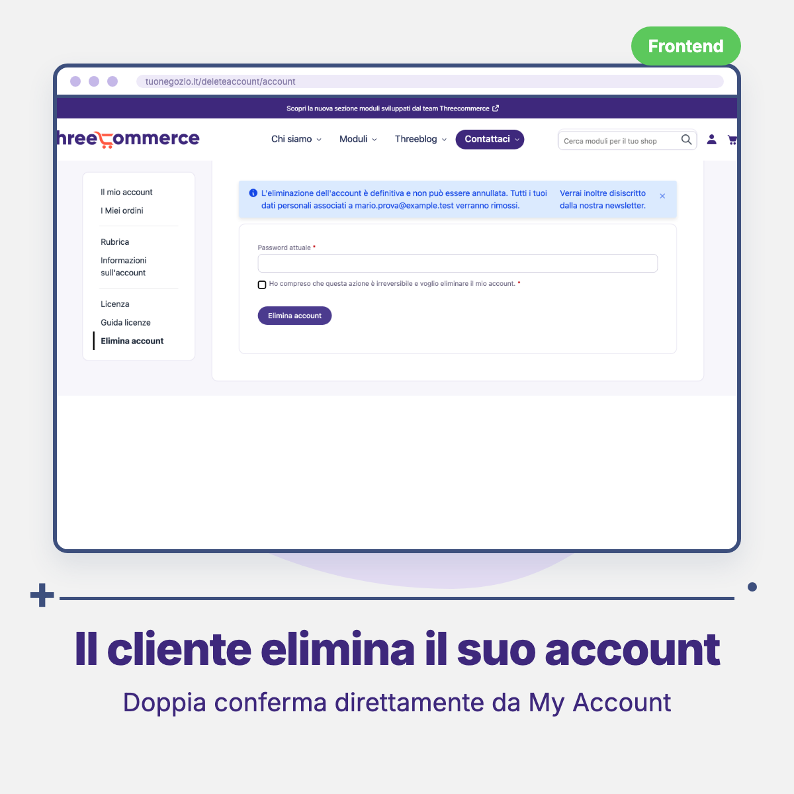
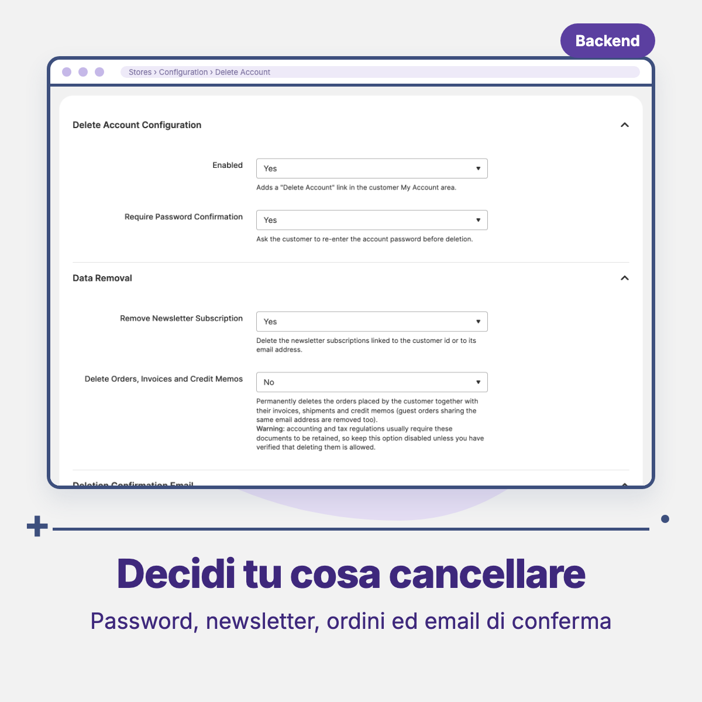

# Threecommerce_DeleteUser: customer account deletion for Magento 2 / Mage-OS

Lets customers **delete their own account** from the **My Account** area, next to *Account Information* and *Change Password*. Useful to handle "right to erasure" requests without involving the store owner.

**Compatibility:** Magento Open Source / Adobe Commerce 2.4.4+ · Mage-OS · PHP 8.1 – 8.4 · Themes: Luma, Hyvä, Breeze
**License:** commercial · coming soon

## Features

- **Delete Account** entry in the My Account sidebar.
- Confirmation page with an irreversibility warning and a confirmation checkbox.
- Optional **password re-entry** before the deletion.
- Newsletter subscription removed together with the account (all websites, matched by customer id and email).
- Optional deletion of the customer's orders, invoices, shipments and credit memos (guest orders with the same email included). **Off by default**: accounting and tax rules usually require keeping them. When off, orders stay in the system with a null customer id, as in native Magento.
- Transactional confirmation email, with a selectable template.
- Works with Luma, Hyvä and Breeze (native `customer_account_navigation` block, markup without Luma widgets).
- English interface with Italian translation.

## Requirements

- Magento Open Source / Adobe Commerce 2.4.4+ or Mage-OS
- PHP 8.1 – 8.4

## Availability

This module is **not yet available for purchase**. See the [product page](https://www.threecommerce.it/elimina-account-cliente-magento-2?utm_source=github&utm_medium=readme&utm_campaign=magento2-delete-user) for the current status, or [get in touch](https://www.threecommerce.it/contatti?utm_source=github&utm_medium=readme&utm_campaign=magento2-delete-user) to be notified when it is released or to ask for details.

## Configuration

Admin → **Stores → Configuration → Threecommerce Plugins → Delete Account**: enable the feature, require password confirmation, remove newsletter subscription, delete orders/invoices/credit memos, and the confirmation email (send on/off, sender, template).

## Documentation and support

- Product page: [threecommerce.it/elimina-account-cliente-magento-2](https://www.threecommerce.it/elimina-account-cliente-magento-2?utm_source=github&utm_medium=readme&utm_campaign=magento2-delete-user)
- [Changelog](CHANGELOG.md) (in Italian)
- Questions and custom development: [threecommerce.it/contatti](https://www.threecommerce.it/contatti?utm_source=github&utm_medium=readme&utm_campaign=magento2-delete-user)

---

*This repository is the public showcase of the module. The source code is kept in a private repository.*
